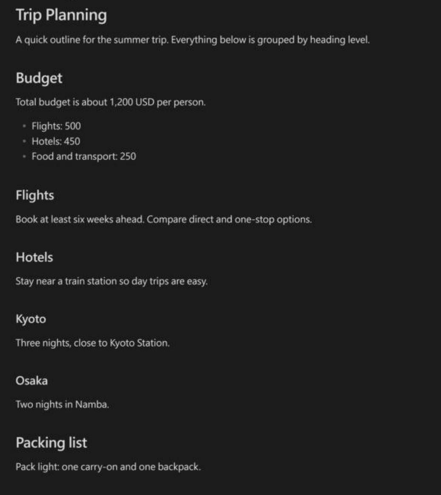

# Heading Indent Guides

See the structure of long notes at a glance. Content under each heading is indented by its level, a vertical guide line runs down every level, and heading sizes are easier to tell apart.

| Without the plugin | With Heading Indent Guides |
|---|---|
|  |  |

## Features

- **Indent by heading level**: text, lists, code blocks, tables, and callouts move right to match the heading they belong to.
- **Vertical guide lines**: one thin line for each level, so you can see where a section starts and ends.
- **Clearer headings**: larger size and weight differences between H1–H6, and an underline under H1.
- Works in **Live Preview**, **Source mode**, **Reading view**, and **PDF export**, on desktop and mobile.

## Installation

1. Open **Settings → Community plugins** and turn off Restricted mode if it is on.
2. Select **Browse**, search for **Heading Indent Guides**, then **Install** and **Enable**.

If you also use *Heading Level Indent*, turn it off so content is not indented twice.

## Settings

| Setting | What it does |
|---|---|
| Settings language | Language of the settings page. **Auto** follows your Obsidian interface language. |
| Vertical guide lines | Show or hide the guide lines. |
| Clearer headings | Turn the larger heading sizes, weights, and H1 underline on or off. |
| Treat the highest heading as H1 | If a note only uses `##` and below, `##` becomes the first level, so nothing is indented by an extra step. |
| Indent per level | How far (in px) content under H1–H6 moves to the right. The guide lines follow automatically. |

The settings page is available in English, 繁體中文, 简体中文, 日本語, 한국어, Español, Français, Deutsch, Português (Brasil), and Русский. Other interface languages show English.

To turn indentation off for a single note, add this to its frontmatter:

```yaml
---
heading-indent: false
---
```

## Customizing the guide lines

Create a CSS snippet (**Settings → Appearance → CSS snippets**) so your changes are kept when the plugin updates:

```css
body.hli-guides {
  --hli-color: var(--text-muted);  /* line color */
  --hli-w: 2px;                    /* line width */
  --hli-gap: 12px;                 /* distance between the line and the text */
}
```

---

## 中文說明

讓長筆記的層級一眼看清楚：標題底下的內容依層級往右縮排，每一層左邊有一條垂直參考線，各級標題的大小、粗細差異也更明顯。即時預覽、原始碼模式、閱讀模式和 PDF 匯出都有效果，電腦版和手機版都能用。

**安裝**：設定 → 第三方外掛 → 瀏覽 → 搜尋 **Heading Indent Guides** → 安裝 → 啟用。如果有裝 *Heading Level Indent*，請先關掉，不然會重複縮排。

**設定**：可以開關垂直參考線、開關加大標題差異、選擇是否把筆記中最大的標題當成 H1，以及調整 H1～H6 底下內容的縮排距離，參考線會自動跟著移動。設定頁面支援 10 種語言，預設跟著 Obsidian 的介面語言，也可以在「設定頁面語言」自己選。

**單篇筆記關閉縮排**：在 frontmatter 加上 `heading-indent: false`。

**自訂參考線**：到「設定 → 外觀 → CSS 片段」新增一個片段，貼上上面「Customizing the guide lines」的 CSS 再修改數值。不要直接改外掛的 `styles.css`，外掛更新時會被覆蓋。

## License

[MIT](LICENSE)
